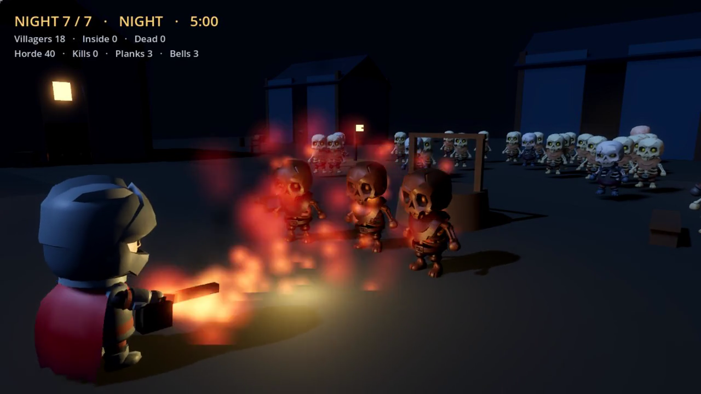
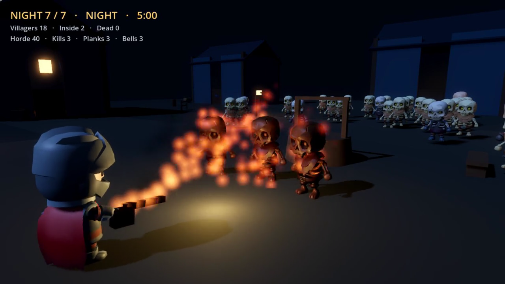
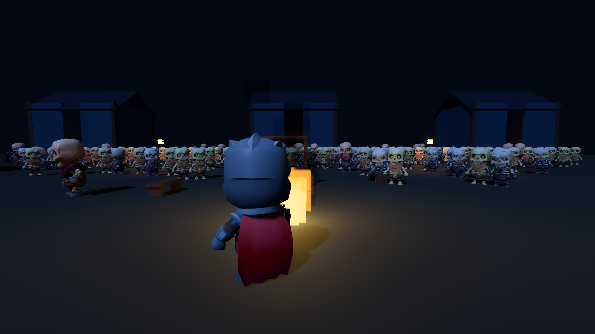

# Godor

A third-person survival greybox in Godot 4.7.2. You are the last defender of a
village. The flamethrower holds **16.6 seconds** of fuel. The horde reaches 200
bodies. Seven nights, then dawn.

Built against `PLAN.md`; current phase status and honest gaps are in
`docs/PHASE_STATUS.md`.

## Screenshots





The flame clip (8 s / 60 s / 90 s) lives in `docs/evidence/` and is rendered
offline via Movie Maker mode. See `docs/evidence/README.md` for provenance.

## Run it

```bash
godot --headless --path . --import   # once after cloning
godot --path .
```

Godot 4.7.2 with Forward+ and Jolt. No addons, no dataset download.

## Controls

| Input | Action |
|---|---|
| `WASD` / arrows | Move |
| Mouse | Look |
| `Shift` | Sprint |
| Right mouse | Aim (slower, tighter flame) |
| Left mouse | Fire |
| `E` | Board or repair a door |
| `Q` | Ring the bell (+20% horde that night, 3 charges) |
| `1` `2` `3` | Dusk cache choice |
| `Esc` | Pause |
| `F3` | Metrics overlay |
| `F9` | Save now |

## Verify

```bash
godot --headless --path . res://tests/test_runner.tscn   # 187 assertions
godot --headless --path . -- --smoke --fresh             # full seven-night run
tools/perf.sh 20 4                                      # 200-zombie stress, strict budgets
tools/ci/check.sh --require-lint                         # the full gate
```

`perf.sh` needs a real GPU. The current machine is an Intel HD 4400 and fails
the 16.6 ms budget; the measurement and the hardware are recorded in
`docs/evidence/perf.json` rather than hidden.

## What is real

- 120 m greybox village: nine houses, gatehouse, doors with HP and boarding,
  torches, props, three spawn edges.
- Player movement, sprint stamina, over-shoulder camera, interaction.
- Flamethrower: 8 m / 45° / 12-ray fan, 18 direct dps plus burn DoT, fuel drain,
  a hot core plus a cooler edge layer and a smoke tail.
- 200-zombie cap, shambler/runner/brute, flow-field pathing, door raiders, lunges,
  burn death, distance LOD.
- 15 villagers with utility AI, jobs, dusk sheltering, stuck recovery.
- 7-night loop with dusk choices, dawn tally, save/load, permadeath, HUD.
- Headless test suite (187 assertions), smoke run, perf harness, strict perf
  checker, CI workflow, offline capture harness for feel clips.
- 60 s and 90 s staged feel takes committed in `docs/evidence/` (flame lit to the
  cut in both).

## What is not

- No imported art, animation, audio, or final lighting; all meshes are
  procedural. Phase 3 is not started.
- The perf gate is unproven on reference hardware. The dev GPU cannot reach
  60 fps.
- No human playtest, controller support, or Steam packaging.

Design decisions live in `docs/decisions/`. Phase status and honest gaps in
`docs/PHASE_STATUS.md`.
EOF
echo "written"